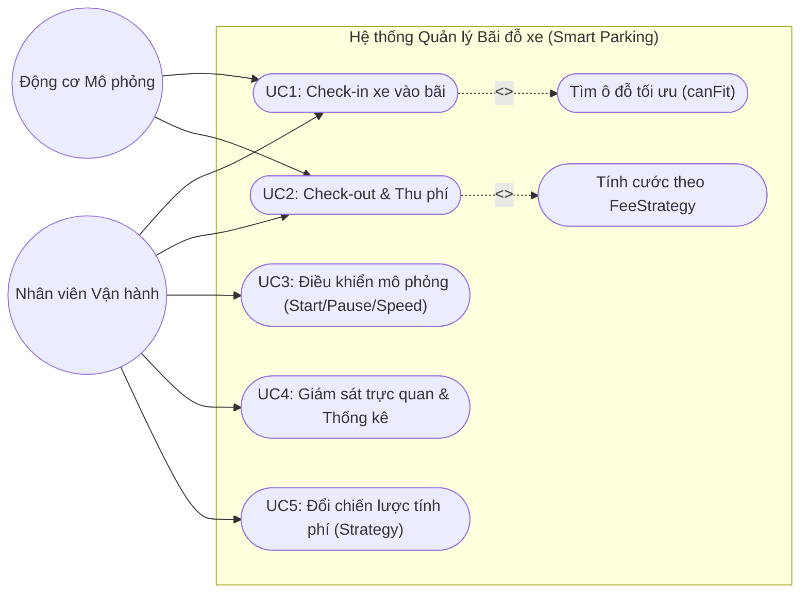
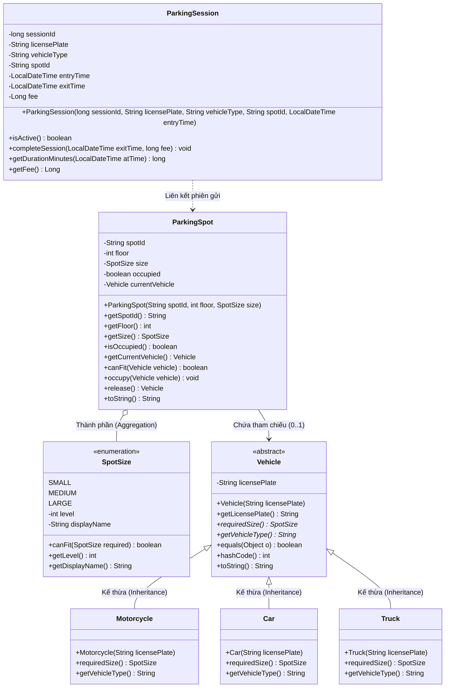

# TÀI LIỆU THIẾT KẾ MÔ HÌNH HÓA UML (ASTAH & CLASS DIAGRAM)
**Môn học:** Object-Oriented Language and Theory (IT3100 / IT3103 - PGS. Lê Đức Hậu)  
**Đề tài:** Hệ thống Quản lý và Mô phỏng Bãi đỗ xe Thông minh (Smart Parking Simulator)  
**Tác giả:** Trưởng nhóm (Thành viên 1 - Software Architect & Domain Modeler)  

---

## 1. Biểu đồ Use Case (Use Case Diagram - Slide 02-2)

### Các tác nhân (Actors):
1. **Operator (Nhân viên vận hành):** Người thực hiện các thao tác quản lý trực tiếp bằng tay trên hệ thống.
2. **Simulation System (Hệ thống mô phỏng tự động):** Tác nhân tự động (Timer/Bot) phát sinh luồng xe và sự kiện thời gian.
3. **Database (Hệ quản trị CSDL SQLite):** Hệ thống lưu trữ phụ trợ để lưu phiên gửi xe.

### Danh sách Use Cases chính:
- **UC1: Check-in Xe (Nhận xe vào bãi):**
  - Actor: Operator, Simulation System.
  - Luồng: Nhập biển số -> Hệ thống quét ô đỗ còn trống tối ưu theo `canFit` -> Đổi trạng thái ô sang CÓ XE -> Tạo `ParkingSession`.
- **UC2: Check-out Xe (Trả xe & Thu cước):**
  - Actor: Operator, Simulation System.
  - Luồng: Chọn ô đỗ/biển số -> Tính thời gian đỗ -> Áp dụng `FeeStrategy` tính tiền -> Đổi trạng thái ô sang TRỐNG -> Đóng `ParkingSession`.
- **UC3: Điều khiển Mô phỏng (Simulation Control):**
  - Actor: Operator.
  - Luồng: Bắt đầu (Start), Tạm dừng (Pause), Đổi tốc độ (1x, 2x, 5x), Đổi cơ chế tính cước (Hourly vs Flat).
- **UC4: Giám sát & Báo cáo thống kê (View Metrics & Stats):**
  - Actor: Operator.
  - Luồng: Xem tỷ lệ lấp đầy trực tiếp, tổng doanh thu, số xe bị từ chối do hết chỗ, xem nhật ký thời gian thực.

---

## 2. Biểu đồ Lớp (Class Diagram - Tầng Model & Phân Tầng Hệ Thống)

Mô hình hóa chi tiết cấu trúc các lớp theo đúng 4 trụ cột OOP (Slide 03, 06, 07):

---

## 3. Hướng dẫn Nhóm trưởng vẽ trên phần mềm Astah (Slide 00, 02-2)
1. Mở phần mềm **Astah Community / Professional**.
2. Tạo file mới: `Parking_Simulator_Design.asta`.
3. **Use Case Diagram:**
   - Chọn `Diagram` -> `Use Case Diagram`.
   - Kéo 2 Actor (`Operator`, `Simulation System`) và 5 Use Cases như trên.
   - Nối quan hệ `Association`, `<<include>>` vào Use Case con.
4. **Class Diagram:**
   - Chọn `Diagram` -> `Class Diagram`.
   - Tạo các Class `Vehicle` (bật cờ `Abstract`), `Motorcycle`, `Car`, `Truck`.
   - Dùng mũi tên `Generalization` (tam giác rỗng) từ 3 lớp con chỉ về `Vehicle`.
   - Tạo enum `SpotSize` và class `ParkingSpot`. Dùng quan hệ `Aggregation` hoặc `Association`.
5. Lưu file `.asta` vào thư mục `docs/` để nộp cùng mã nguồn cho thầy Lê Đức Hậu.
